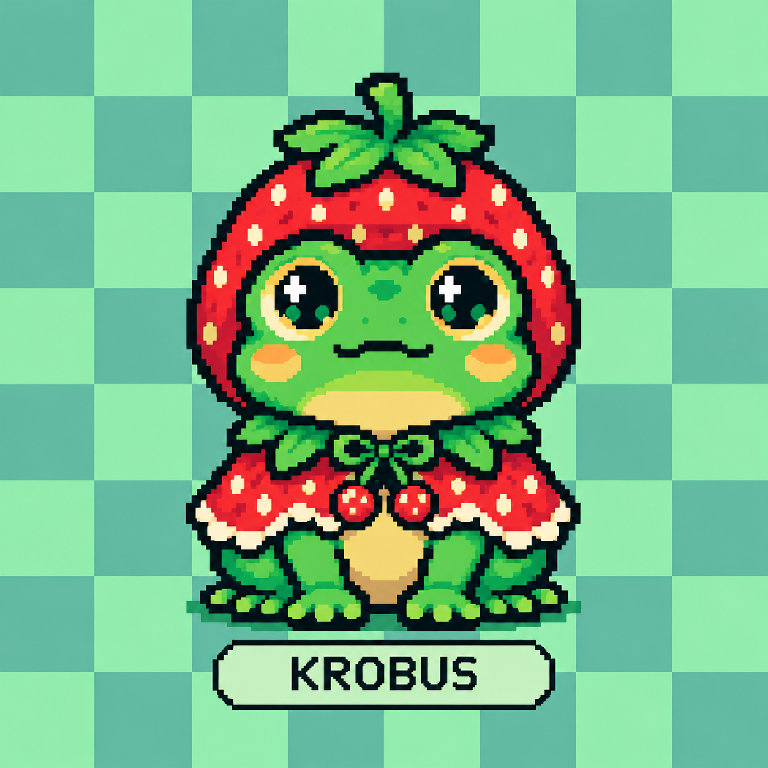
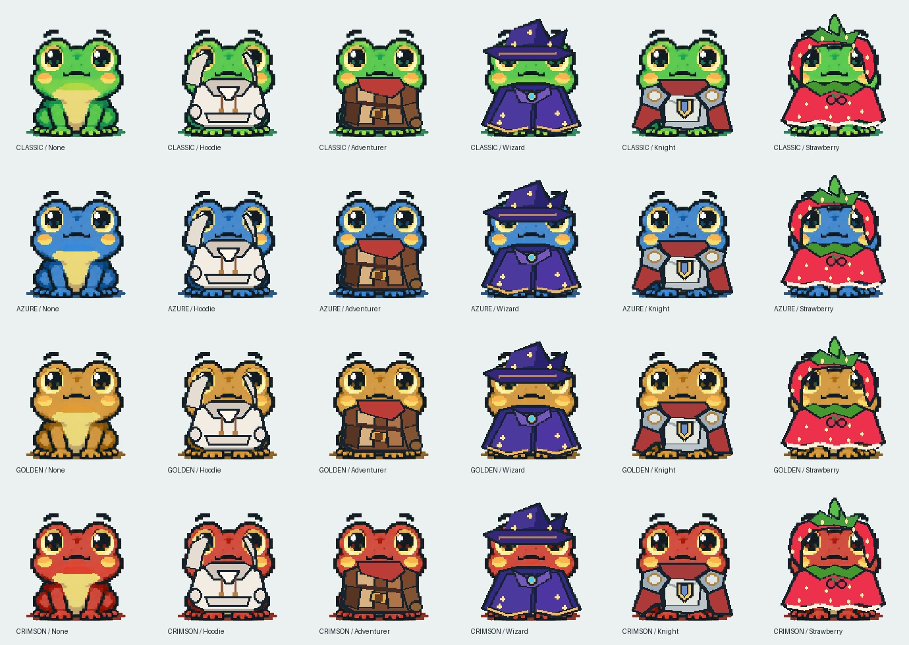
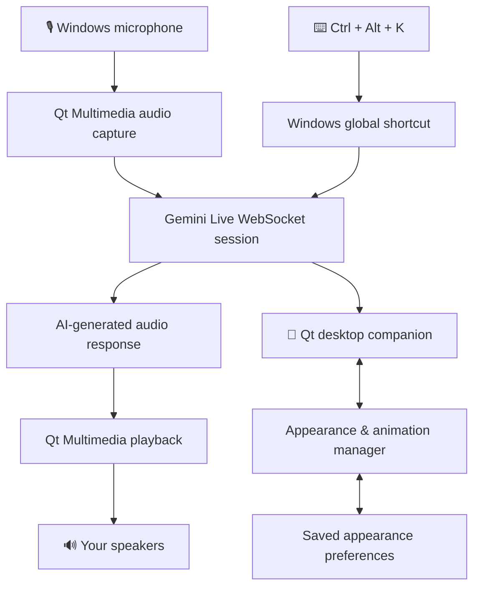

<div align="center">



# 🐸 KROBUS

### A little frog. A real conversation. A more delightful desktop.

**A voice-first AI desktop companion for Windows — built with C++ and Qt, powered by Gemini Live.**

<p>
  
  
  
  
</p>

**[⬇️ Download KROBUS](https://github.com/Krobus2001/KROBUS/releases/latest)** · **[✨ Features](#features)** · **[🎨 Looks](#appearances)** · **[🛠️ Build](#building)**

<sub>Made with code, curiosity, and an unreasonable amount of affection for pixel frogs.</sub>

</div>

---

## 🌱 What is KROBUS?

KROBUS isn't another chat window waiting for you to type. He's a tiny, animated **pixel-art frog who lives on your Windows desktop**, reacts with different expressions, changes outfits, and talks back when you speak to him.

Press **`Ctrl + Alt + K`**, say what's on your mind, and hear KROBUS respond aloud through **Gemini Live**. When the conversation ends, he returns to his little desktop world.

KROBUS started as an experiment in making AI interaction feel more like having a character around than opening a conventional chatbot. The result is a lightweight desktop companion with a surprisingly large wardrobe.

> **Meet your smallest coworker.** He has no meetings, no deadlines, and six outfits more than he needs. 🐸

<a id="features"></a>

## ✨ What can KROBUS do?

| | Feature | What it means |
|:--:|---|---|
| 🎙️ | **Talk naturally** | Speak into your microphone and hear AI-generated voice responses. |
| ⌨️ | **Global voice shortcut** | Press **`Ctrl + Alt + K`** to start listening; press it again to stop/cancel. |
| 🐸 | **Live on your desktop** | A transparent, draggable, always-on-top companion with movement and idle behavior. |
| 😊 | **Express himself** | Six moods: **idle, happy, thinking, sad, surprised,** and **sleeping**. |
| 🎨 | **Change colors** | Choose **Classic, Azure, Golden,** or **Crimson**. |
| 👕 | **Dress up** | Mix in **None, Hoodie, Adventurer, Wizard, Knight,** or **Strawberry**. |
| 💾 | **Remember his look** | Appearance selections are saved between launches. |
| 🖱️ | **Stay out of the way** | Show, hide, customize, or quit from KROBUS's desktop/tray controls. |
| 💤 | **Rest between chats** | Returns to idle after a response; sleep and offline behavior are part of the character experience. |

<div align="center">

**4 frog colors × 6 outfits = 24 possible appearances**

</div>

<a id="appearances"></a>

## 🎨 Meet the frogs

<div align="center">
  
  <p><sub>Classic • Azure • Golden • Crimson — each with six outfit choices.</sub></p>
</div>

Your frog, your style. Keep him classic, dress him for an adventure, give him a wizard hat, or go full strawberry royalty.

## 📥 Download & install

### Recommended: Windows installer

1. Go to **[KROBUS Releases](https://github.com/Krobus2001/KROBUS/releases)**.
2. Open the newest published release.
3. Under **Assets**, download the file named similar to **`KROBUS_Setup_1.x.x.exe`**.
4. Run the installer and follow the on-screen instructions.
5. Launch **KROBUS** from your desktop or Start menu.
6. Set up your Gemini API key as described below, then talk to your frog.

> **Note:** If there is no release available yet, the installer has not been published. The source code alone is not a ready-to-run standalone application.

### Requirements

- **Windows 64-bit** desktop or laptop
- A **working microphone** and speakers/headphones
- **Internet access** for Gemini Live conversations
- A valid **Gemini API key** with access to the configured Live model

The installer is designed to bundle the required Qt runtime libraries. You do **not** need Qt Creator just to run an installed release.

### 🔑 Configure your Gemini API key

KROBUS currently reads the API key from the Windows environment variable **`GEMINI_API_KEY`**. It does not ship with the creator's private API key.

1. Obtain your own key from **[Google AI Studio](https://aistudio.google.com/app/apikey)**.
2. On Windows, search for **Edit environment variables for your account**.
3. Under **User variables**, select **New**.
4. Enter **`GEMINI_API_KEY`** as the variable name and paste your key as its value.
5. Save, then **fully close and reopen KROBUS**. If launching through Qt Creator, restart Qt Creator too.

**Never commit your API key to GitHub**, include it in screenshots, or ship it inside a public installer.

## 🎤 How to talk to KROBUS

<div align="center">

```text
       Press Ctrl + Alt + K
                │
                ▼
          🎙️ KROBUS listens
                │
                ▼
          🗣️ You speak
                │
                ▼
        ✨ Gemini Live replies
                │
                ▼
           🔊 KROBUS talks
                │
                ▼
          🐸 Back to idle
```

</div>

**Try asking:**

- “Hey KROBUS, how's your day going?”
- “Tell me something interesting about space.”
- “What should I work on today?”
- “Who created you?”
- “Tell me a story about a brave little frog.”

KROBUS is designed around **push-to-talk activation**, not always-on wake-word listening. The initial listening session has a timeout if no speech is detected, and the hotkey can cancel a session.

### Quick controls

| Action | Control |
|---|---|
| Start a voice session | **`Ctrl + Alt + K`** |
| Cancel an active session | **`Ctrl + Alt + K`** again |
| Move KROBUS | **Drag the frog** |
| Customize appearance | **Appearance** in KROBUS's menu |
| Show/hide or quit | **System tray menu** |

## 🧠 Under the lily pad

KROBUS combines a native Windows/Qt character interface with a live AI audio connection.



### Tech stack

| Layer | Technology |
|---|---|
| Desktop application | **C++ / Qt 6 Widgets** |
| User interface | Transparent, animated pixel-art window |
| Audio | **Qt Multimedia** |
| AI conversation | **Gemini Live API** over WebSocket |
| Windows integration | Global keyboard shortcut, system tray, startup integration |
| Local preferences | **QSettings** |
| Build system | **CMake** and MinGW toolchain |
| Windows packaging | **Qt deployment tools** and **Inno Setup** |

<a id="building"></a>

## 🛠️ Build from source

Want to explore the code or work on your own build?

### Prerequisites

- Windows and **Qt Creator**
- **Qt 6.12** (MinGW 64-bit kit used for development)
- CMake and a matching MinGW compiler
- The Qt modules and third-party dependencies referenced by `CMakeLists.txt`
- Your own Gemini API key for live voice features

### In Qt Creator

1. Clone or download this repository.
2. Open **`CMakeLists.txt`** in **Qt Creator**.
3. Select a compatible **Qt 6 MinGW 64-bit** kit.
4. Configure the project and check any paths for bundled third-party dependencies.
5. Choose **Release** for a distributable build, then **Build**.
6. Configure **`GEMINI_API_KEY`** in your environment.
7. Run KROBUS from Qt Creator to test the application.

**Distributing your own build?** A plain `build/.../Release/KROBUS.exe` may not run by itself on a computer without Qt installed. Use **`windeployqt`** to gather the required Qt DLLs and plugins, then include the frog assets and other runtime dependencies. The repository's Inno Setup script is intended to package that prepared standalone folder.

### Project layout

```text
KROBUS/
├── appearances/         # Frog colors, outfits, and mood sprites
├── assets/              # Character assets and supporting files
├── docs/                # Images used by this README
├── third_party/          # External libraries, where applicable
├── wakeword/             # Experimental wake-word resources
├── CMakeLists.txt        # Qt/CMake project definition
├── main.cpp              # Application entry point
├── mainwindow.cpp        # Desktop companion and AI behavior
├── mainwindow.h
├── mainwindow.ui
├── krobus.qrc            # Qt resource definitions
├── wakeworddetector.cpp  # Experimental wake-word integration
├── wakeworddetector.h
├── KROBUS.ico             # Windows application icon
├── krobus_icon.rc        # Windows icon resource
├── KROBUS_Installer.iss   # Inno Setup packaging script
└── README.md
```

Local **`build/`**, **`dist/`**, and **`installer_output/`** directories are generated for development and packaging and normally aren't committed to the source repository.

## 🔒 Privacy, keys & limitations

- **Voice requires a network connection:** microphone audio is sent to the configured Gemini service during active voice conversations to generate responses. Review the provider's applicable terms and privacy information.
- **Bring your own API key:** the project does not include a shared/public Gemini key. Usage limits and availability depend on Google's service and your account.
- **Not an offline voice assistant:** local frog behavior can run independently, but Gemini-powered conversations require access to the API.
- **Not an always-listening wake-word assistant:** the reliable activation method is the `Ctrl + Alt + K` shortcut. Wake-word detection has been explored experimentally.
- **Independent project:** KROBUS is a personal development project, not an official Google or Qt product.
- **Windows security prompts:** self-distributed unsigned installers may be flagged for reputation checks; only download releases from this repository and verify the source before running software.

## 🩹 Troubleshooting

<details>
<summary><b>“GEMINI_API_KEY was not found”</b></summary>

Check that `GEMINI_API_KEY` exists under your Windows **User variables**, that the value is correct, and that you restarted KROBUS after adding it. If launched by Qt Creator, restart that application as well.

</details>

<details>
<summary><b>“Qt6Multimedia.dll was not found”</b></summary>

You probably started the raw EXE from the CMake Release build directory. Run the **installed version** or the **deployed standalone folder**, which should contain the required Qt DLLs and plugins.

</details>

<details>
<summary><b>KROBUS doesn't respond to Ctrl + Alt + K</b></summary>

Check that KROBUS is running, another application hasn't claimed the same global shortcut, and your microphone permissions allow desktop apps to access the microphone.

</details>

<details>
<summary><b>Gemini answers aren't playing</b></summary>

Verify your speakers, microphone permissions, internet connection, API key access, and the configured Gemini Live model's availability.

</details>

## 🌷 Ideas for the future

These are **possible improvements**, not promises about the current release:

- [ ] A simpler in-app setup screen for the user's own Gemini API key
- [ ] More reliable optional wake-word activation
- [ ] Additional characters, outfits, and animations
- [ ] More expressive voice and conversation options
- [ ] Broader accessibility and packaging improvements

## 🤝 Contributing & feedback

Found a bug or have an idea for a new outfit? Open an **[Issue](https://github.com/Krobus2001/KROBUS/issues)**. Pull requests are welcome for discussion, but please open an issue first for larger changes.

When reporting a problem, include your Windows version, the KROBUS version, what you expected, what happened, and any **redacted** logs. **Never share API keys** in issues or screenshots.

## 📜 License

**A project license has not been declared in this README.** Please check the repository for a `LICENSE` file before reusing or redistributing source code or artwork. Third-party components and the Gemini service have their own applicable terms.

## 👑 Creator

<div align="center">

**Blaise Tyrel B. Daga**  
*Developer · BS Information Systems student · Pixel frog enthusiast*

Built with **C++**, **Qt**, **Gemini Live**, persistence, debugging, creativity, and one very determined frog.

**[GitHub @Krobus2001](https://github.com/Krobus2001)**

---

### 🐸 One frog. A thousand conversations.

*Thanks for stopping by KROBUS's little corner of the internet.*

</div>
